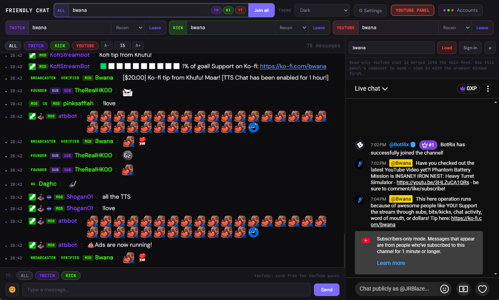

# Friendly Chat

A desktop app that merges live chat from Twitch, Kick and YouTube into one unified window. Built with Electron.


## What it does

Friendly Chat lets you watch and participate in Twitch, Kick and YouTube chats in one place.

- View Twitch, Kick and YouTube chat in a single merged feed
- Join the same channel name on every platform at once with **Join all**
- Open a YouTube live chat from a channel name or `@handle` — no need to hunt down the livestream URL
- Filter the feed by platform
- Send messages to Twitch and Kick at once (YouTube sends from its own panel)
- Load recent chat history when you join a channel, with the original timestamps
- Reopen recently joined channels from a local recent-chat list
- Emotes from every source each platform supports: Twitch global/channel/sub/follower emotes, Kick global, emoji and channel emotes, YouTube emoji and channel member emotes, plus 7TV, BTTV and FrankerFaceZ
- Kick's full emote list loads the moment you join, and its global set is cached so it is there before you join anything
- Sound and/or desktop notification when your name is mentioned, each toggled separately
- Tab autocomplete for emotes (`:emote`) and mentions (`@username`), plus a searchable emote picker
- Favorite emotes with the star in the picker; favorites appear first, followed by streamer groups and then other categories
- Optional quick access bar with up to eight recently sent emotes, shared across Twitch and Kick; turn it on or off in Settings
- Recall sent messages with Up/Down, and copy a message from its username menu
- Recover dropped connections automatically, including five-minute cooldowns after exhausted retry bursts and Kick’s replacement chat connection
- Suspend offscreen feed images to reduce resource use on busy chats
- Hover any emote — in the feed, the picker or the autocomplete — for a large preview with its name and where it came from
- `/me` renders as an action, not as the raw `ACTION` wrapper Twitch sends it in
- Replies say what they are answering, quoted above the reply with its emotes intact
- First messages are marked, on the platform's own say-so rather than a guess
- Usernames wear the colour their owner picked, nudged until it is readable on whichever theme you are using
- `@mentions` of other people are drawn in that person's own colour, once this feed has seen them speak
- Click a username to reply, timeout, ban, or delete messages — a reply threads onto the original on Twitch rather than only @mentioning them
- Adjustable font size that saves between sessions
- Light, dark, and match-system theme modes
- Tells you when a new release is on GitHub and installs it for you



## Download

Grab the latest installer for your platform from the [Releases](../../releases) page.

### Mac Installation Note

If you see **"Friendly Chat is damaged and can't be opened"** when launching on Mac, this is due to Apple's Gatekeeper blocking unsigned apps. To fix it, open **Terminal** and run:

```
xattr -cr /Applications/Friendly\ Chat.app
```

Then try opening the app again. Alternatively go to **System Settings → Privacy & Security** and click **Open Anyway** if the option appears there.

## Getting started

1. Launch Friendly Chat
2. Click **Accounts** and connect Twitch and/or Kick
3. Type a channel name and click **Join**, or use the **ALL** box and **Join all** to open the same name on every platform at once
4. For YouTube, type the channel name, its `@handle`, or a livestream URL — Friendly Chat finds whatever that channel is streaming right now

You can watch and read chats without signing in. Signing in is only required to send messages.

## Mention alerts

Open **Settings** to choose what happens when someone says your name:

- **Play a sound** — a short chime generated in the app, with a volume slider. No sound file to install.
- **Show a desktop notification** — uses your operating system's notification centre.

The two toggles are independent, so you can have sound only, notification only, both, or neither. Your connected Twitch and Kick account names are always highlighted; add any other names you go by in **Extra names to highlight**.

Alerts are rate limited to one every 1.2 seconds, and channel history replayed on join never triggers them.

## Emotes

Emote catalogs load when you join. The picker and `:name` autocomplete offer emotes with current access, while locked emotes and emotes merely seen in received messages can still render in the feed. A fresh Twitch user catalog refreshes subscription availability without deleting saved favorites or recent names. Kick subscription access requires an affirmative channel response; moderator rights do not grant subscriber emotes.

Emotes are drawn everywhere a viewer typed one, not only in ordinary chat messages: the message under
a resub, the text of an announcement and the original quoted above a reply all go through the same
renderer a chat message does. The summary wrapped around an event does not — so a display name that
happens to spell an emote name stays a name rather than turning into a picture.

Kick needs a little care because its emote endpoint sits behind Cloudflare. Friendly Chat asks for it through a hidden Electron window that carries the app's own session (so a channel you subscribe to returns its subscriber emotes), falls back to the local server in browser mode, tries both of Kick's emote paths, and retries a couple of times if the first request is turned away. Kick's global and emoji sets are cached separately from channel sets, so they are restored at startup with no channel joined. Collecting emotes from live messages still exists, but only as a last resort.

The picker lists **Favorites** first, then streamers alphabetically, then categories such as global emotes, emoji and collectibles. Each emote appears once per platform. Search keeps those groups and does not lose focus as catalogs refresh. Star buttons change favorites without inserting an emote or closing the picker.

The **Quick access emote bar** setting defaults to on. It shows the eight newest available emotes across joined Twitch and Kick channels, reducing the number to fit one row on narrow windows. Recent emotes are recorded after a successful send. Favorites and recent names stay on this device, and Twitch and Kick histories keep their platform identity. Clicking a recent emote inserts its name into the app composer. Kick native emotes are converted to Kick’s wire format when sent. Emote-only messages go only to destinations where every emote is available; Cheer text stays on Twitch.

## Moderation and recovery

The original username menu keeps API-supported delete, timeout, ban and unban actions for authenticated moderators and broadcasters. **Delete this message** acts on the clicked row, even when a newer message from the same person exists. Invalid actions and timeout durations are rejected before requests are sent. Twitch also offers **Pin for 5m**, **Pin until stream ends**, and **Unpin** for the clicked message through its [documented pins API](https://dev.twitch.tv/docs/api/reference/#pin-chat-message), using the existing chat-message moderation scope. YouTube keeps its original panel workflow.

Connections have bounded retry bursts followed by an automatic five-minute cooldown. Channel changes cancel pending recovery and discard late lookups. Twitch and Kick sockets send health pings and close unresponsive connections. Twitch tokens are revalidated hourly; temporary validation outages preserve the session. Incoming Twitch Gigantify metadata enlarges only the last native emote, and YouTube role badges use validated image URLs.

These additions run through the standalone app’s existing interface and APIs. Browser overlays, extension setup pages, native Share/claim controls, native GIF posting, paid-send controls and native pin actions are not included. The Chrome extension is only a read-only reference.

## Updates

Friendly Chat checks GitHub for a newer release on launch and every six hours. When one exists, a banner appears at the top of the window with the version, the release notes behind a **What's new** toggle, and one button that does the work:

- **Windows** — downloads the installer with a progress bar and launches it, then closes the app so the installer can replace it.
- **macOS** — downloads the `.dmg` and opens it, ready for you to drag Friendly Chat into Applications.
- **Linux** — downloads the new `.AppImage`, makes it executable and opens the folder containing it.

Nothing downloads or installs on its own; the banner just gets you there in two clicks. **Later** hides the banner until the next check, **Skip this version** silences that particular release for good, and **Settings → Updates** has a manual *Check for updates now*, a toggle to stop checking automatically, and a way to clear a skipped version.

The app deliberately does not use electron-updater. Its silent self-update needs a code-signed application, and the macOS builds here are unsigned, so it would work on two platforms out of three and fail confusingly on the third. Downloading the installer and handing it to the operating system behaves identically everywhere and adds no runtime dependency.

## Performance

**Settings → Performance** controls how many messages the feed keeps (200–5000, default 500). Older messages are dropped so a stream you leave open all day stays responsive. You can also turn off the message fade-in animation for the smoothest scrolling on very busy channels.

## How YouTube works

YouTube has no public chat API that works from a channel name alone, and a browser cannot read youtube.com directly because of cross-origin rules. Friendly Chat's local server does the work instead:

1. It loads the channel's `/live` page to find the video that is streaming now.
2. It reads the live chat page once for YouTube's own continuation token.
3. It long-polls YouTube's live chat endpoint and hands normalized messages back to the app.

No API key, OAuth client or third-party service is involved. Messages, author badges, Super Chats, memberships and custom channel emoji all render in the merged feed.

The panel on the right still embeds YouTube's own chat widget. That is what you use to *send* YouTube messages: click **Sign in**, complete browser sign-in, and use the composer inside the panel. The shared message box remains Twitch and Kick only, because sending to YouTube would require a Google OAuth client.

If YouTube changes its payloads or the stream ends, the merged feed says so and the panel keeps working on its own.

## Development

```
npm install
npm start      # run the app
npm test       # run the full offline test suite
```

The test suite loads the real `friendly-chat.html` into jsdom with the network stubbed, then drives the app the way a user would: joining channels on all three platforms, rendering emotes from every source, filtering, sending, moderating, autocompleting, changing settings, and pushing thousands of messages through the feed to check it stays bounded. The server and YouTube parsers are covered separately. Nothing in the suite touches the network.

Run one suite with `node tests/run.js <name>` (`youtube`, `updater`, `server`, `render`, `app`, `improvements`, `perf`).

`npm run test:features` runs the shared feature and Electron bootstrap unit tests. `npm run test:coverage` runs the full offline app suite with V8 coverage of the actual inline renderer, the bootstrap tests, and c8 coverage of `app-features.js`. It gates all shared-feature statements, branches, functions and lines at 100%, and separately gates changed executable renderer/server/main lines, functions and V8 block ranges at 100% against the current Git diff. Set `FC_COVERAGE_BASE` to a commit or tag to include committed changes; GitHub checks use the PR base or the preceding main commit. Invalid base references fail the check. These are changed-code measurements, not a claim of 100% coverage of the historical application. Reports are written to `coverage/`. GitHub runs these checks on Node 20 and 24 before merging release changes.

`npm run test:smoke` opens a hidden Electron test window with an isolated temporary profile and offline fixtures. It checks the original preload, the emote picker order, the toggle, and one-row quick-bar geometry at 1280, 800 and 520px. It saves `app-smoke.png`; it does not send chat, moderate a live channel, or access signed-in platform windows.

## Built with

- [Electron](https://www.electronjs.org)
- [Twitch IRC](https://dev.twitch.tv/docs/irc/)
- [Kick Pusher WebSocket](https://kick.com)
- YouTube live chat (the same endpoint youtube.com's own chat page uses)
- [BTTV](https://betterttv.com) / [7TV](https://7tv.app) / [FrankerFaceZ](https://www.frankerfacez.com) emotes
- [recent-messages.robotty.de](https://recent-messages.robotty.de) for Twitch chat history
